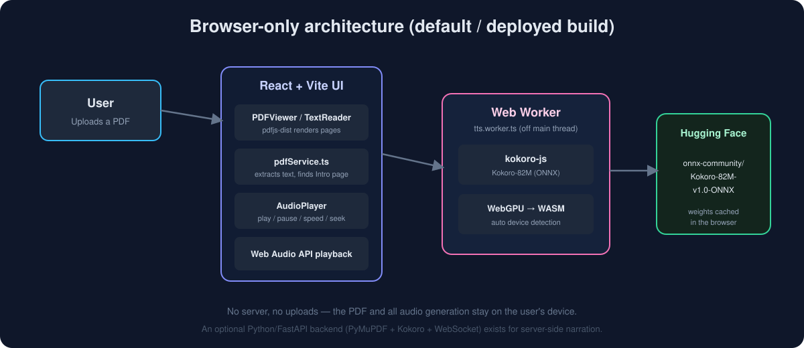

<p align="center">
  
</p>

<h1 align="center">📚 AI Audiobook Reader</h1>

<p align="center">
  Upload a PDF and have it read aloud with a natural, neural voice — entirely in your browser.<br/>
  Narration is generated on-device by the open-source <b>Kokoro-82M</b> text-to-speech model.
</p>

<p align="center">
  
  
  
  
  
  
</p>

---

## ✨ Project summary

**AI Audiobook Reader** turns any PDF book into a listenable audiobook. You drop in a PDF, the app extracts the text, automatically jumps to the book's *Introduction*, and reads the pages aloud sentence by sentence while highlighting words as they are spoken. You can pause, resume, change the speed, flip pages, and click any word to start reading from there.

The project ships in two flavours that share the same idea and the **same voice model (Kokoro-82M)**:

| | Browser-only build (default) | Python backend (optional) |
|---|---|---|
| **Where text is extracted** | In the browser with `pdfjs-dist` | On the server with PyMuPDF (`fitz`) |
| **Where speech is generated** | In the browser with `kokoro-js` (ONNX, WebGPU/WASM) | On the server with the `kokoro` Python package |
| **Transport** | None — everything is local | WebSocket stream (`/api/tts/stream`) |
| **Privacy** | The PDF never leaves your device | PDF is uploaded to the backend |
| **Deployment** | Static site → GitHub Pages | Run `uvicorn` locally |

The **default, deployed experience is 100% client-side** — no server, no uploads. The Python/FastAPI backend is an earlier implementation kept in the repo for server-side narration and reference.

---

## 🗺️ Architecture

<p align="center">
  
</p>

**Request flow (browser build):**

1. The user selects a PDF in the React UI.
2. `pdfService.ts` uses `pdfjs-dist` to extract the text of every page and detect the *Introduction* page from heading font sizes.
3. `PDFViewer` renders the pages; `TextReader` shows the extracted text.
4. `AudioPlayer` asks `ttsService.ts` for audio one sentence at a time.
5. A **Web Worker** (`tts.worker.ts`) runs **kokoro-js** off the main thread. It auto-detects **WebGPU** (falling back to **WASM**), downloads the Kokoro-82M ONNX weights from Hugging Face (cached afterwards), and returns raw audio samples.
6. Samples are played through the **Web Audio API**, with word-level highlighting synced to playback.

---

## 🎙️ The voice: Kokoro-82M (open-source TTS)

Narration is produced by **[Kokoro-82M](https://huggingface.co/hexgrad/Kokoro-82M)**, a compact (~82 million parameter) open-weight neural text-to-speech model released under the **Apache-2.0** license. Despite its small size it produces natural, expressive speech, which makes it practical to run on a laptop — or even directly inside a web browser.

| Detail | Value |
|---|---|
| **Model** | Kokoro-82M |
| **Parameters** | ~82 million |
| **License** | Apache-2.0 (open source, commercial use allowed) |
| **Output sample rate** | 24 kHz |
| **Voice used in this app** | `af_sky` (American English, female) |
| **Language code** | `a` (American English) |
| **Browser runtime** | [`kokoro-js`](https://www.npmjs.com/package/kokoro-js) on ONNX Runtime (WebGPU / WASM) |
| **Browser weights** | [`onnx-community/Kokoro-82M-v1.0-ONNX`](https://huggingface.co/onnx-community/Kokoro-82M-v1.0-ONNX) |
| **Python runtime** | [`kokoro`](https://pypi.org/project/kokoro/) package (`KPipeline`) |

**Why it fits this project**
- 🆓 **Open source** — no API keys, no per-character billing, no vendor lock-in.
- 🔒 **Private** — in the browser build, text is never sent anywhere; speech is synthesized locally.
- ⚡ **Fast & small** — runs on WebGPU when available, WASM otherwise; the Python backend uses an 8-bit/full-precision path depending on device.
- 🎚️ **Controllable** — adjustable speaking speed (0.5×–2.5×) and selectable voices.

> Kokoro-82M is developed by the Kokoro / hexgrad community and distributed on Hugging Face. This project simply consumes the published model.

---

## 🧩 Features

- 📄 **PDF upload** (up to 100 MB) with drag-and-drop.
- 🔎 **Automatic "Introduction" detection** — opens the book at its real start, skipping covers and tables of contents, by comparing heading font size to the body text.
- 🗣️ **Sentence-by-sentence streaming narration** for a smooth, low-latency start.
- ✨ **Word highlighting** synced to the audio, with click-to-start-from-here.
- ⏯️ **Playback controls** — play, pause, resume, stop, and **0.5×–2.5× speed**.
- 📑 **Dual view** — switch between the rendered **PDF** and clean extracted **Text**.
- ⌨️ **Keyboard shortcuts** (`useKeyboardShortcuts`).
- 🧠 **On-device inference** with automatic **WebGPU → WASM** fallback.
- 🔁 **Smart skipping** of near-empty pages.
- 🚀 **Zero-backend deployment** to GitHub Pages.

---

## 📁 Project structure

```
book reader/
├── assets/                      # README images (banner, architecture diagram)
├── .github/workflows/
│   └── deploy-pages.yml         # CI: builds the frontend & deploys to GitHub Pages
├── frontend/                    # React + TypeScript + Vite (the deployed app)
│   ├── index.html
│   ├── package.json
│   ├── vite.config.ts
│   └── src/
│       ├── App.tsx              # Top-level UI & state
│       ├── components/
│       │   ├── PDFViewer/       # Renders PDF pages (pdfjs-dist)
│       │   ├── TextReader/      # Extracted-text view with word highlighting
│       │   └── AudioPlayer/     # Playback controls & narration driver
│       ├── services/
│       │   ├── pdfService.ts    # In-browser PDF text extraction + Intro detection
│       │   ├── ttsService.ts    # Main-thread bridge to the speech worker
│       │   └── narration.ts     # Narration orchestration
│       ├── hooks/
│       │   ├── useAudioStream.ts
│       │   ├── useKeyboardShortcuts.ts
│       │   └── usePDFText.ts
│       └── workers/
│           ├── tts.worker.ts    # Runs Kokoro-82M via kokoro-js (WebGPU/WASM)
│           └── ttsMessages.ts   # Worker message types
│
└── backend/                     # Optional Python / FastAPI server (server-side narration)
    ├── main.py                  # FastAPI app + CORS + routers
    ├── requirements.txt         # Runtime deps (Python 3.9–3.12)
    ├── routers/
    │   ├── pdf.py               # POST /api/pdf/upload, GET /api/pdf/books/{id}
    │   └── tts.py               # WebSocket /api/tts/stream
    └── services/
        ├── pdf_service.py       # PyMuPDF text extraction + Intro detection
        └── tts_service.py       # Kokoro TTS streaming (voice af_sky, 24 kHz)
```

---

## 🚀 Getting started

### Option A — Browser-only app (recommended)

No Python needed. Everything runs client-side.

**Prerequisites:** Node.js 20+ (CI uses Node 24).

```bash
cd frontend
npm install
npm run dev        # starts Vite on http://localhost:5173
```

Build a production bundle:

```bash
npm run build      # outputs to frontend/dist
npm run preview    # preview the production build locally
```

> The first time you play audio, the browser downloads the Kokoro-82M ONNX weights (~tens of MB). This happens once and is cached. A browser with **WebGPU** gives the fastest synthesis; otherwise it falls back to **WASM**.

### Option B — With the Python backend

Use this if you want text extraction and TTS to run on a server.

**Prerequisites:** Python **3.9–3.12** (Kokoro does not support 3.13+).

```bash
cd backend
python -m venv venv312
venv312\Scripts\activate        # Windows (PowerShell/CMD)
# source venv312/bin/activate   # macOS / Linux
pip install -r requirements.txt

uvicorn main:app --reload --port 8000
```

API surface:

| Method | Endpoint | Purpose |
|---|---|---|
| `GET` | `/` | Health message |
| `GET` | `/health` | Health check |
| `POST` | `/api/pdf/upload` | Upload a PDF, returns extracted pages + `start_page` |
| `GET` | `/api/pdf/books/{book_id}` | Fetch a previously uploaded book |
| `WS` | `/api/tts/stream` | Stream narration audio + word timings |

The WebSocket accepts `start` / `pause` / `resume` / `stop` actions and streams JSON timing messages followed by binary WAV chunks.

> If Kokoro isn't installed, the backend falls back to silent placeholder audio so the pipeline still runs.

---

## 🌐 Deployment

The repo includes a GitHub Actions workflow (`.github/workflows/deploy-pages.yml`) that:

1. Builds `frontend/` with Node 24 (`npm ci --ignore-scripts && npm run build`).
2. Uploads `frontend/dist` as a Pages artifact.
3. Deploys it to **GitHub Pages**.

It triggers on pushes to `main` that touch `frontend/**` (or the workflow file), and can also be run manually. `vite.config.ts` uses `base: './'` so the site works from a project subpath like `/<repo>/`.

---

## 🛠️ Tech stack

**Frontend:** React 18, TypeScript 5, Vite 5, `pdfjs-dist`, `kokoro-js` (ONNX Runtime, WebGPU/WASM), Web Workers, Web Audio API.

**Backend (optional):** Python, FastAPI, Uvicorn, PyMuPDF (`fitz`), `kokoro`, `soundfile`, NumPy, WebSockets.

---

## 🙏 Acknowledgements

- **[Kokoro-82M](https://huggingface.co/hexgrad/Kokoro-82M)** — the open-source neural TTS model behind every voice in this app.
- **[kokoro-js](https://www.npmjs.com/package/kokoro-js)** — browser runtime for Kokoro on ONNX.
- **[PDF.js](https://mozilla.github.io/pdf.js/)** and **[PyMuPDF](https://pymupdf.readthedocs.io/)** — PDF text extraction and rendering.
- **[FastAPI](https://fastapi.tiangolo.com/)** — the backend framework.

---

## 📄 License

The application code is available under the **Apache-2.0** license. The Kokoro-82M model is likewise distributed under **Apache-2.0** by its authors. Please review each dependency's license for your own use case.

<p align="center"><sub>Built with ❤️ — an open-source, privacy-first audiobook reader.</sub></p>
